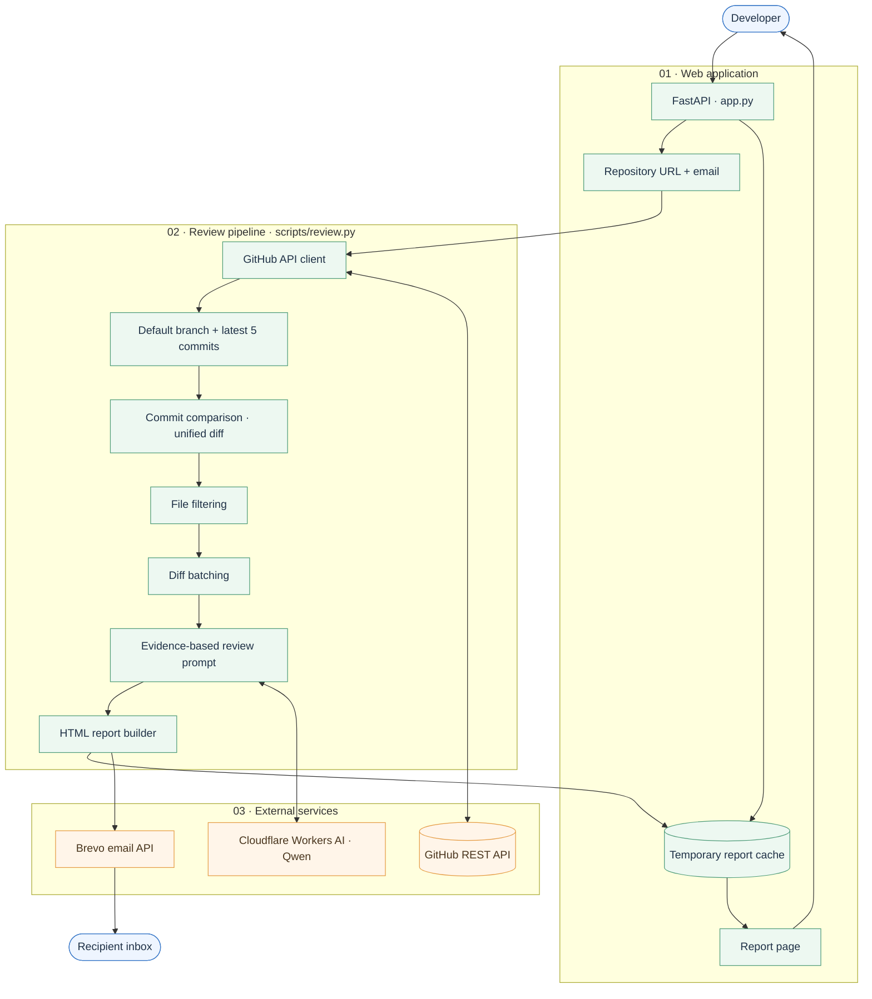
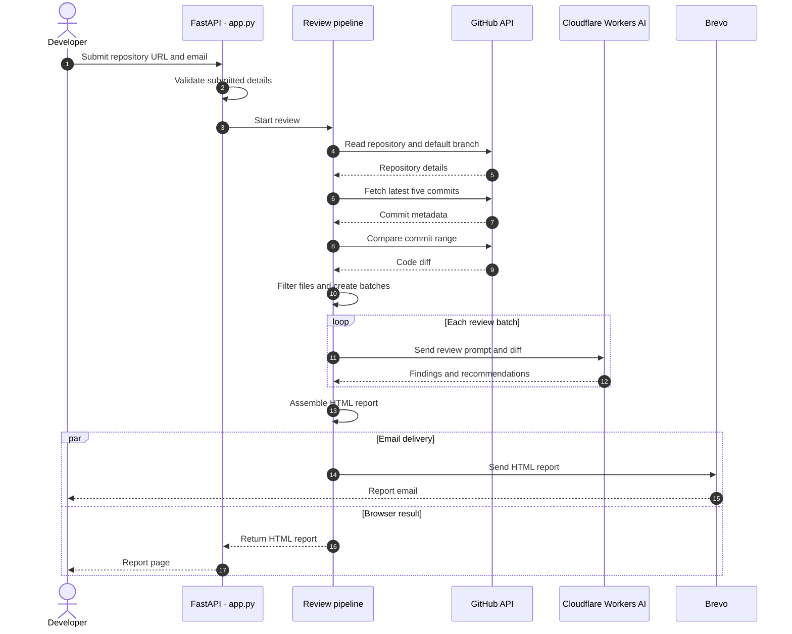
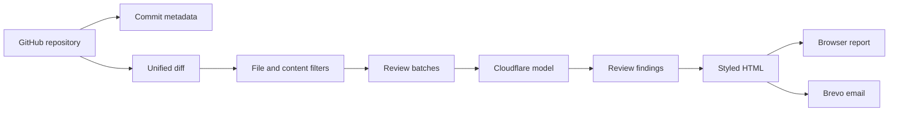

<!--
  AI Code Reviewer
  Documentation maintained in the project repository.
-->

<div align="center">

# AI Code Reviewer

### Review recent GitHub changes. Understand issues. Improve with confidence.

A focused code-review workflow that collects recent commits, analyses changed code with Cloudflare Workers AI, and delivers a clear HTML report by email.

<br/>

[](https://github.com/Raj-Rathod-Ai/AI-Code-Reviewer)
[](https://www.python.org/)
[](https://fastapi.tiangolo.com/)
[](https://developers.cloudflare.com/workers-ai/)

<br/>

**Built by [Raj Rathod](https://github.com/Raj-Rathod-Ai)**

</div>

---

## ✦ What it does

AI Code Reviewer turns recent repository changes into an organised review. Submit a public GitHub repository URL and an email address. The application fetches the latest five commits from the default branch, prepares the code diff, sends review batches to Cloudflare Workers AI, builds a styled HTML report, and delivers it through Brevo.

## Highlights

| | Capability | What it does |
|:--:|---|---|
| ◈ | **Recent commit analysis** | Reviews the latest five commits from the repository's default branch. |
| ◉ | **GitHub integration** | Collects repository details, commit metadata, and code differences through the GitHub REST API. |
| ✧ | **AI code analysis** | Uses a configurable Cloudflare Workers AI model to examine changed code. |
| ⌘ | **Focused file filtering** | Skips configured generated folders, binary patches, dependency lock files, and sensitive file types. |
| ▤ | **Batch processing** | Splits larger diffs into manageable model requests. |
| ✓ | **Structured findings** | Groups results into Error, Warning, and Suggestion categories. |
| ▧ | **HTML report** | Creates a readable report with commit details, findings, recommendations, and creator branding. |
| ✉ | **Email delivery** | Sends the report as an HTML email using Brevo. |
| ◎ | **Web interface** | Accepts repository and email details and displays the generated report. |

---

## Architecture

The application separates the web experience from the code-review pipeline. FastAPI handles user requests and report display; the review module coordinates GitHub, Cloudflare Workers AI, report generation, and email delivery.

### System architecture



### Request sequence



### Review data flow



---

## How a review works

<details open>
<summary><strong>01 · Submit a repository</strong></summary>

The developer enters a public GitHub repository URL and a recipient email address on the homepage. FastAPI checks the submitted URL and email before starting the review.
</details>

<details>
<summary><strong>02 · Collect recent changes</strong></summary>

The review module reads the repository's default branch, retrieves up to five latest commits, and requests the GitHub compare diff for the selected commit range. Commit identifiers, messages, and dates are collected for the report.
</details>

<details>
<summary><strong>03 · Prepare review input</strong></summary>

The diff is separated into file sections. Configured generated folders, dependency lock files, binary patches, and sensitive files are skipped. Remaining changes are grouped into batches.
</details>

<details>
<summary><strong>04 · Analyse with Cloudflare Workers AI</strong></summary>

Each batch is sent to the configured model with instructions to focus on evidence in the supplied changes. The review prompt asks for concrete explanations and practical recommendations rather than unsupported assumptions.
</details>

<details>
<summary><strong>05 · Build and deliver the report</strong></summary>

The responses are assembled into a styled HTML report. The report includes repository details, recent commit information, findings, and creator attribution. Brevo sends the HTML report to the submitted email address, and FastAPI returns a browser report page.
</details>

## Finding format

The review prompt organises findings into three categories:

| Category | Intended use |
|---|---|
| **Error** | Bugs, broken behaviour, and serious security concerns |
| **Warning** | Potential defects, risky patterns, and performance concerns |
| **Suggestion** | Readability, maintainability, and code-quality improvements |

A finding can contain a title, severity, file name, line number when available, explanation, impact, and recommendation or corrected code.

---

## Technology stack

<div align="center">

| Layer | Technology | Role |
|---|---|---|
| User interface and routes | **FastAPI** | Homepage, form handling, report route |
| Application server | **Uvicorn** | Runs the web application |
| Source control data | **GitHub REST API** | Repository, commits, and diffs |
| Model inference | **Cloudflare Workers AI** | Analyses changed code |
| Default model | **Qwen 2.5 Coder 32B Instruct** | Code-focused review |
| Email delivery | **Brevo API** | Sends HTML reports |
| HTTP requests | **Requests** | Calls external APIs |
| Configuration | **python-dotenv** | Loads local environment variables |
| Hosting | **Render** | Hosts the web service |

</div>

## Project structure

```text
AI-Code-Reviewer/
│
├── .github/
│   └── workflows/
│       └── python-app.yml
│
├── scripts/
│   ├── __init__.py
│   └── review.py
│
├── app.py
├── requirements.txt
├── render.yaml
├── .gitignore
├── .env.example
└── README.md
```

---

## Run locally

### 1. Clone the repository

```bash
git clone https://github.com/Raj-Rathod-Ai/AI-Code-Reviewer.git
cd AI-Code-Reviewer
```

### 2. Create a virtual environment

**Windows PowerShell**

```powershell
python -m venv venv
.\venv\Scripts\Activate.ps1
```

**macOS / Linux**

```bash
python3 -m venv venv
source venv/bin/activate
```

### 3. Install dependencies

```bash
pip install -r requirements.txt
```

### 4. Configure environment variables

Create a `.env` file in the project root:

```env
CLOUDFLARE_ACCOUNT_ID=your_cloudflare_account_id
CLOUDFLARE_API_TOKEN=your_cloudflare_api_token
CLOUDFLARE_MODEL=@cf/qwen/qwen2.5-coder-32b-instruct

BREVO_API_KEY=your_brevo_api_key
SENDER_EMAIL=your_verified_sender_email

# Optional: authenticated GitHub API requests
GITHUB_TOKEN=your_github_token
```

Keep this file private. Do not commit API tokens or email credentials to the repository.

### 5. Start the application

```bash
uvicorn app:app --reload
```

Open **http://127.0.0.1:8000** in your browser.

---

## Configure external services

### Cloudflare Workers AI

1. Sign in to the [Cloudflare Dashboard](https://dash.cloudflare.com/).
2. Open Workers AI and enable access for your account.
3. Create an API token with the required Workers AI permissions.
4. Copy the Account ID and API token.
5. Set `CLOUDFLARE_ACCOUNT_ID`, `CLOUDFLARE_API_TOKEN`, and `CLOUDFLARE_MODEL` in your environment.

The model identifier is configurable. The default in this project is:

```text
@cf/qwen/qwen2.5-coder-32b-instruct
```

See the [Workers AI model catalogue](https://developers.cloudflare.com/workers-ai/models/) for available models.

### Brevo

1. Sign in to [Brevo](https://www.brevo.com/).
2. Create an API key.
3. Verify the sender email address.
4. Set `BREVO_API_KEY` and `SENDER_EMAIL`.
5. Submit a review and check the recipient inbox.

---

## Deploy to Render

The repository contains a `render.yaml` file for a Render Blueprint deployment. You can also create a **Web Service** manually:

1. Open the [Render Dashboard](https://dashboard.render.com/).
2. Select **New + → Web Service**.
3. Connect this GitHub repository and choose the `main` branch.
4. Select **Python** as the runtime.
5. Set the build command:

   ```bash
   pip install -r requirements.txt
   ```

6. Set the start command:

   ```bash
   uvicorn app:app --host 0.0.0.0 --port $PORT
   ```

7. Add the environment variables listed below in Render's Environment section.
8. Create the service and open the public URL provided by Render.

### Environment variables

| Name | Required | Purpose |
|---|:---:|---|
| `CLOUDFLARE_ACCOUNT_ID` | Yes | Cloudflare account identifier |
| `CLOUDFLARE_API_TOKEN` | Yes | Workers AI API authorisation |
| `CLOUDFLARE_MODEL` | No | Model identifier; uses the configured default when omitted |
| `BREVO_API_KEY` | Yes | Brevo email API key |
| `SENDER_EMAIL` | Yes | Verified sender address |
| `GITHUB_TOKEN` | No | Authenticated GitHub API access |

Add secrets through Render's dashboard. Never put secret values in `render.yaml` or commit them to Git.

---

## Why use AI Code Reviewer?

- **Focused feedback:** directs the review toward recent changes and their diff context.
- **Clear explanations:** organises findings into understandable categories.
- **Practical next steps:** provides impact descriptions and recommendations.
- **Shareable results:** creates a browser-friendly HTML report and sends it by email.
- **Modular design:** keeps web routes separate from the GitHub and AI review workflow.
- **Configurable inference:** allows the model to be selected through an environment variable.
- **Developer-friendly setup:** supports local development and Render hosting.

---

## Creator

<div align="center">

### Made with care by [Raj Rathod](https://github.com/Raj-Rathod-Ai)

[](https://github.com/Raj-Rathod-Ai)

[Project repository](https://github.com/Raj-Rathod-Ai/AI-Code-Reviewer)

</div>

---

## License

Distributed under the **MIT License**. See the [LICENSE](LICENSE) file for details.

<div align="center">

<sub>AI Code Reviewer · Built for developers · © 2026 Raj Rathod</sub>

</div>
