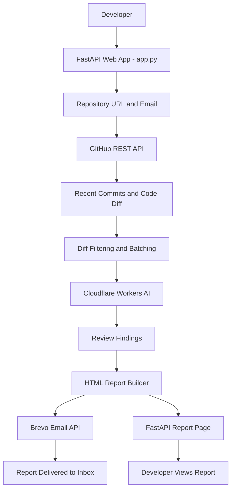

# AI Code Reviewer

A web-based code review tool that examines recent changes in a public GitHub repository and delivers a structured review report by email.

**Made by [Raj Rathod](https://github.com/Raj-Rathod-Ai)**

<p align="center">
  <a href="https://github.com/Raj-Rathod-Ai/AI-Code-Reviewer">GitHub Repository</a>
  ·
  <a href="https://github.com/Raj-Rathod-Ai">Creator Profile</a>
</p>

---

## Overview

AI Code Reviewer helps developers inspect recent code changes without manually reading every changed line. Submit a public GitHub repository URL and an email address. The application collects the latest five commits, prepares the relevant code diff, sends review batches to Cloudflare Workers AI, and creates an HTML report with findings and recommendations.

The report is emailed to the address supplied with the request and is also available in the browser after the review completes.

## Features

- **Recent commit review:** focuses on the latest five commits from the repository's default branch.
- **GitHub integration:** retrieves repository information, commit history, metadata, and code differences through the GitHub REST API.
- **AI-powered analysis:** uses a configurable Cloudflare Workers AI model. The default model is `@cf/qwen/qwen2.5-coder-32b-instruct`.
- **Focused code filtering:** reviews supported source and configuration file types while skipping common generated folders, dependency lock files, binary patches, and sensitive files such as environment and private-key files.
- **Batch processing:** divides larger diffs into manageable review batches.
- **Actionable findings:** organises findings into Error, Warning, and Suggestion categories, with explanations, impact, and recommended fixes.
- **HTML report:** creates a readable report containing repository details, commit information, review findings, and creator attribution.
- **Email delivery:** sends the report as an HTML email through the Brevo API.
- **Web interface:** provides a simple form for submitting a repository URL and email address, then displays the generated report.
- **Creator attribution:** includes a visible creator link and branding in the report.

## Architecture

The application is organised into two main Python modules:

- `app.py` — FastAPI web application, homepage, form handling, report display, and short-lived report cache.
- `scripts/review.py` — GitHub data collection, diff filtering, batch creation, AI requests, HTML report generation, and Brevo email delivery.

### Architecture diagram



## Review workflow

1. **Submit details** — The developer enters a public GitHub repository URL and an email address on the website.
2. **Validate input** — FastAPI checks that the URL points to GitHub and that an email address has been provided.
3. **Read repository details** — The review module identifies the repository's default branch using the GitHub REST API.
4. **Collect recent commits** — The application retrieves up to five latest commits from that branch and records their short SHA, message, and date.
5. **Build the diff** — GitHub's compare endpoint supplies the changes across the selected commit range.
6. **Filter changed files** — The application keeps supported source and configuration files and skips configured generated, binary, dependency, and sensitive files.
7. **Create review batches** — The accepted file diffs are grouped into batches for model requests.
8. **Analyse the changes** — Each batch is sent to the configured Cloudflare Workers AI model with instructions to identify evidence-based bugs, security concerns, performance issues, and maintainability improvements.
9. **Prepare findings** — Model responses are assembled into report sections using Error, Warning, and Suggestion categories.
10. **Generate and deliver the report** — The application creates a styled HTML report and sends it to the submitted email address through Brevo.
11. **Display the report** — FastAPI makes the report available in the browser using a temporary report link.

## Review output

The report is designed to make findings easy to understand and act on. A finding can include:

- Finding title and severity
- Changed file name
- Line number, when available
- Explanation of the problem
- Potential impact
- Recommended correction
- Example corrected code, when appropriate

The report also includes repository information and a summary of the recent commits reviewed.

## Technology stack

| Component | Technology | Responsibility |
|---|---|---|
| Web framework | FastAPI | Website, form submission, and report routes |
| Server | Uvicorn | Runs the FastAPI application |
| Git provider | GitHub REST API | Repository details, commits, and diffs |
| AI inference | Cloudflare Workers AI | Analyses code changes |
| Default model | Qwen 2.5 Coder 32B Instruct | Code-focused review model |
| Email delivery | Brevo API | Sends HTML review reports |
| HTTP client | Requests | Communicates with external APIs |
| Configuration | python-dotenv | Loads environment variables |

## Project structure

```text
AI-Code-Reviewer/
├── app.py
├── scripts/
│   └── review.py
├── requirements.txt
├── render.yaml
├── .gitignore
└── README.md
```

## Getting started

### 1. Clone the repository

```bash
git clone https://github.com/Raj-Rathod-Ai/AI-Code-Reviewer.git
cd AI-Code-Reviewer
```

### 2. Create and activate a virtual environment

**Windows PowerShell**

```powershell
python -m venv venv
.\venv\Scripts\Activate.ps1
```

**macOS / Linux**

```bash
python3 -m venv venv
source venv/bin/activate
```

### 3. Install dependencies

```bash
pip install -r requirements.txt
```

### 4. Configure environment variables

Create a `.env` file in the project root:

```env
CLOUDFLARE_ACCOUNT_ID=your_cloudflare_account_id
CLOUDFLARE_API_TOKEN=your_cloudflare_api_token
CLOUDFLARE_MODEL=@cf/qwen/qwen2.5-coder-32b-instruct

BREVO_API_KEY=your_brevo_api_key
SENDER_EMAIL=your_verified_sender_email

# Optional: improves GitHub API rate limits
GITHUB_TOKEN=your_github_token
```

Keep `.env` private. Do not commit API tokens or email credentials to GitHub. Add the same variables to your hosting provider's environment settings when deploying.

### 5. Start the application

```bash
uvicorn app:app --reload
```

Open [http://127.0.0.1:8000](http://127.0.0.1:8000) in your browser.

## Cloudflare Workers AI setup

1. Create or sign in to a Cloudflare account.
2. Open the Workers AI section and enable access.
3. Create an API token with the permissions required to use Workers AI.
4. Copy your Cloudflare Account ID and API token.
5. Add both values to your `.env` file or hosting environment variables.
6. Set `CLOUDFLARE_MODEL` to the model you want to use. The application defaults to `@cf/qwen/qwen2.5-coder-32b-instruct`.

## Brevo email setup

1. Create or sign in to a Brevo account.
2. Generate an API key.
3. Verify the sender email address you want to use.
4. Set `BREVO_API_KEY` and `SENDER_EMAIL` in your environment.
5. Submit a repository review and check the recipient inbox for the HTML report.

## Deploy on Render

The repository includes a `render.yaml` configuration for Render.

You can also create the service manually:

1. Open [Render Dashboard](https://dashboard.render.com/).
2. Select **New + → Web Service**.
3. Connect this GitHub repository and select the `main` branch.
4. Choose **Python** as the runtime.
5. Set the build command:

   ```bash
   pip install -r requirements.txt
   ```

6. Set the start command:

   ```bash
   uvicorn app:app --host 0.0.0.0 --port $PORT
   ```

7. Add the Cloudflare, Brevo, and optional GitHub environment variables listed above.
8. Create the Web Service and open the public URL provided by Render.

## Environment variables

| Variable | Required | Description |
|---|---|---|
| `CLOUDFLARE_ACCOUNT_ID` | Yes | Cloudflare account used for Workers AI |
| `CLOUDFLARE_API_TOKEN` | Yes | API token authorised for Workers AI |
| `CLOUDFLARE_MODEL` | No | Workers AI model identifier; defaults to Qwen 2.5 Coder 32B Instruct |
| `BREVO_API_KEY` | Yes | Brevo API key used to send email |
| `SENDER_EMAIL` | Yes | Verified sender email address in Brevo |
| `GITHUB_TOKEN` | No | GitHub token for authenticated API requests |

## Benefits

- Turns recent GitHub changes into a structured review.
- Helps developers spot potential bugs and security concerns earlier.
- Explains findings in a consistent format with practical recommendations.
- Keeps the review focused on changed code instead of unrelated repository files.
- Makes review results easy to share through a browser report and email.
- Uses a modular structure that separates the web interface from the review workflow.
- Supports a configurable model through environment variables.
- Can be run locally or deployed as a web service.

## Creator

**Raj Rathod**

- GitHub: [@Raj-Rathod-Ai](https://github.com/Raj-Rathod-Ai)
- Project: [AI Code Reviewer](https://github.com/Raj-Rathod-Ai/AI-Code-Reviewer)

---
